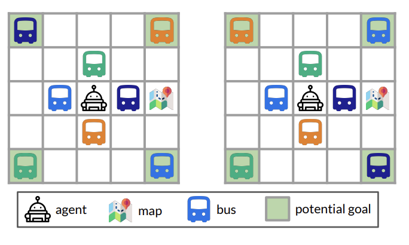
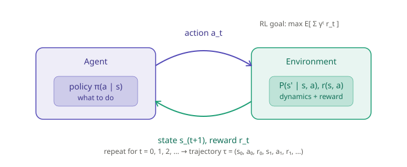
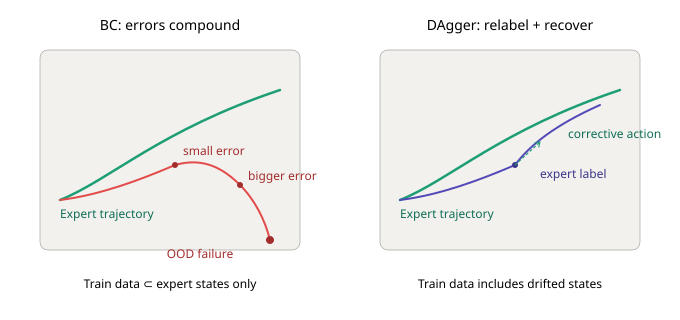
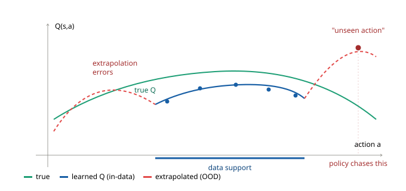
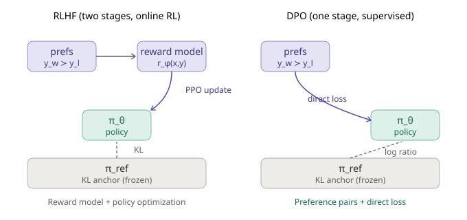

# Deep Reinforcement Learning

**Stanford · Spring 2026**  
Personal notes, writing, and visual experiments by [Brendan P. Murphy](https://csbrendan.github.io/)

[Paper](#paper) · [Articles](#writing) · [MuJoCo demo](#mujoco-in-motion) · [Grid world](#a-grid-world-for-meta-rl) · [Visual notes](#visual-notes)

I took Deep Reinforcement Learning at Stanford in Spring 2026. This repository collects my writing and selected visuals from the course, from learning in simulated environments to using RL to train language models.

## Paper

### [Safe Reinforcement Learning for Clinical Multi-Turn Agents Requires More Than Outcome Rewards](Reward_Design_for_Clinical_Multi_Turn_Agents.pdf)

> **Work in progress.** This is a draft and will be updated.

I study reinforcement learning for clinical agents that must decide what information to request, when to stop gathering evidence, and which action to take. Using three controlled environments (medication refill triage, acute diagnostic workup, and dosing titration), I show that outcome-only reward often raises aggregate reward while producing unsafe procedures such as premature commitment and failures on rare high-risk cases. Giving dense credit to questions that reduce uncertainty improves held-out value and stabilizes high-risk performance.

**[Read the paper (PDF) →](Reward_Design_for_Clinical_Multi_Turn_Agents.pdf)**

## MuJoCo in motion

**[Watch the video →](assets/mujoco-quadruped.mp4)** · 8 seconds · silent MP4

A short excerpt from my MuJoCo MPC coursework recording. MPC uses a dynamics model to plan actions ahead of time. The preview shows the simulation viewport; reward settings and diagnostic panels have been removed.

## Writing

<table>
<tr>
<td width="50%" valign="top">
<h3>Deep RL, Reappearing Inside LLM Post-Training</h3>

How ideas from deep RL show up in instruction tuning, RLHF, DPO, and reasoning. Based on my handwritten course notes.

<a href="https://csbrendan.github.io/blog/2026-10-10-deep-rl-llm-post-training.html"><strong>Read the article →</strong></a>

</td>
<td width="50%" valign="top">
<h3>Deep Reinforcement Learning: A Terms List</h3>

An alphabetical reference to 73 terms, covering imitation learning, offline RL, meta-RL, and LLM post-training.

<a href="https://csbrendan.github.io/blog/2026-10-10-deep-reinforcement-learning-terms.html"><strong>Browse the glossary →</strong></a>

</td>
</tr>
</table>

## A grid world for meta-RL

  

A small environment for studying adaptation across tasks. The illustration shows the agent, map, buses, and potential goals in two task configurations.

*Environment illustration from the Stanford XCS224R assignment materials.*

## Visual notes

These are general concept diagrams from my course cheatsheet. Click an image to view it at full size.

### The agent and the environment

The basic loop behind the rest of the course: act, observe, receive feedback, and learn.

### Imitation learning and distribution shift

Copying expert behavior works best when the states encountered at deployment resemble the demonstrations. This diagram illustrates the general idea of learning from states the policy actually visits.

### Offline RL and data coverage

A fixed dataset leaves gaps. A learned value function can look overly optimistic about actions it has little evidence for. The curves here are conceptual, not experiment results.

### From preferences to a language policy

Two common approaches to preference tuning, connected to the ideas discussed in [my article on LLM post-training](https://csbrendan.github.io/blog/2026-10-10-deep-rl-llm-post-training.html).

---

Homework implementations, reward parameters, and written solutions are kept private. This repository contains my paper, personal writing, general concept diagrams, an environment illustration, and a simulation excerpt.

[Media credits](assets/README.md) · [My blog](https://csbrendan.github.io/blog/) · [GitHub](https://github.com/csbrendan)
